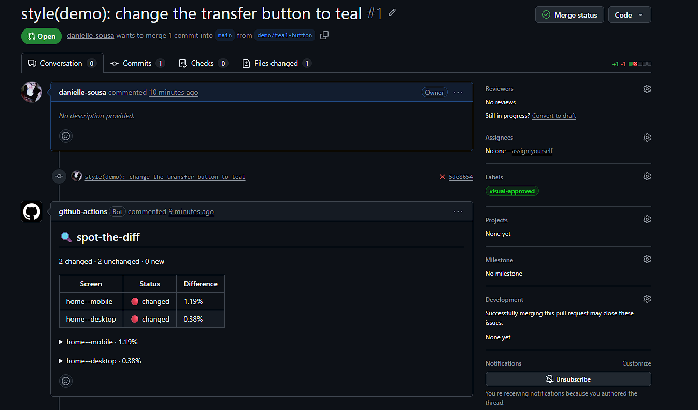
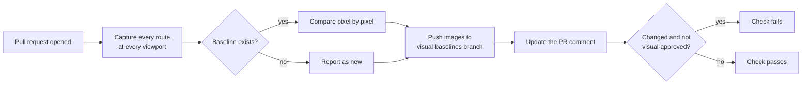

# 🔍 spot-the-diff

**Spot visual changes before your users do.**

spot-the-diff is a GitHub Action that screenshots your app on every pull request, compares each screen with the approved version and comments on the pull request with before, after and diff images. No cloud service, no account, no extra infrastructure: everything lives in your own repository.

[](https://github.com/danielle-sousa/spot-the-diff/actions/workflows/visual.yml)
[](LICENSE)



👉 **See it live:** [demo pull request](https://github.com/danielle-sousa/spot-the-diff/pull/DEMO_PR_NUMBER) where a button changes color.

## Why

Code review shows what changed in the code, not what changed on the screen. A CSS tweak, a new design token or a refactored component can break a layout on a page nobody opened during review. With more code written by AI assistants, these silent visual regressions became easier to ship.

spot-the-diff puts the screens themselves into the review.

## Features

- **Zero infrastructure.** Images are stored on an orphan branch of your repository. No bucket, no SaaS, no secrets to configure.
- **Routes, not tests.** List your routes and viewports in a JSON file. There are no test files to write.
- **Built against false positives.** Animations are frozen, fonts are awaited, anti-aliasing is ignored and dynamic areas such as dates can be masked.
- **One comment per pull request.** It is updated on every push instead of piling up.
- **Explicit approval.** Changes fail the check until someone adds the `visual-approved` label, so a visual change is always a decision.
- **Accessible reports.** Every image in the comment has descriptive alt text for screen reader users.
- **Local CLI.** Run the same check on your machine before you push.

## How it works



On every push to the default branch, spot-the-diff records the screenshots as the new baselines, because whatever reached that branch was already reviewed.

## Project status

spot-the-diff is an early release. The Action currently runs from this repository's own build, so it can be tried here with the [bank demo](examples/bank-demo) but not yet added to other repositories. Publishing the packages to npm and the Action to the GitHub Marketplace is the next milestone.

## Try it locally

You need Node.js 22.18 or newer (24 recommended), pnpm and git.

```bash
git clone https://github.com/danielle-sousa/spot-the-diff.git
cd spot-the-diff
pnpm install
pnpm build
pnpm --dir packages/core exec playwright install chromium
```

Start the demo app in one terminal:

```bash
cd examples/bank-demo
pnpm start
```

In a second terminal, from the same folder:

```bash
pnpm visual            # first run: every screen is new
pnpm visual:approve    # accept them as baselines
```

Now change the button color in `examples/bank-demo/site/styles.css` and run the check again:

```bash
pnpm visual --fail-on-diff
```

The terminal lists the screens that changed, and `.spot-the-diff/current/report.md` shows the same report the pull request comment would.

## Configuration

Create a `visual.config.json`:

```json
{
  "baseUrl": "http://localhost:4200",
  "viewports": [
    { "name": "mobile", "width": 390, "height": 844 },
    { "name": "desktop", "width": 1440, "height": 900 }
  ],
  "routes": [
    { "name": "home", "path": "/" },
    {
      "name": "statement",
      "path": "/statement",
      "waitFor": "[data-testid=statement-list]",
      "mask": [".last-updated"]
    }
  ]
}
```

| Field | Required | Default | Description |
| --- | --- | --- | --- |
| `baseUrl` | yes | | Where the app is running. A sub-path such as `http://localhost:4200/app` is kept. |
| `viewports` | yes | | Screen sizes to capture. Each has a `name`, `width` and `height`. |
| `routes` | yes | | Pages to capture. Each has a `name` and a `path` starting with `/`. |
| `routes[].waitFor` | no | | CSS selector that must be visible before the screenshot is taken. |
| `routes[].mask` | no | `[]` | CSS selectors of dynamic areas, painted over before comparing. |
| `threshold` | no | `0.1` | Per-pixel color tolerance from 0 to 1. Smaller is stricter. |
| `maxDiffPercent` | no | `0` | Share of changed pixels, in percent, that still counts as unchanged. |

Route and viewport names become file names such as `home--mobile.png`, so they use lowercase letters, digits and single hyphens. When the config has a mistake, every problem is reported at once.

## GitHub Action

```yaml
name: Visual regression

on:
  pull_request:
    types: [opened, synchronize, reopened, labeled]
  push:
    branches: [main]

permissions:
  contents: write
  pull-requests: write

jobs:
  visual:
    runs-on: ubuntu-latest
    steps:
      - uses: actions/checkout@v7
      # Build your app and start it in the background here.
      - uses: danielle-sousa/spot-the-diff@v1
        with:
          config: visual.config.json
          fail-on-diff: true
```

The `labeled` event type lets the check run again when the approval label is added. See [the workflow of this repository](.github/workflows/visual.yml) for a complete, working example.

### Inputs

| Input | Default | Description |
| --- | --- | --- |
| `config` | `visual.config.json` | Path to the config file. |
| `baseline-branch` | `visual-baselines` | Branch that stores baselines and pull request screenshots. |
| `fail-on-diff` | `false` | Fail the check when a screen changed, until the `visual-approved` label is added. |
| `github-token` | `github.token` | Token used to push screenshots and comment on the pull request. |

### Outputs

| Output | Description |
| --- | --- |
| `changed` | Number of screens that changed. |
| `new` | Number of screens without a baseline. |

### Approving changes

When a change is intended, add the `visual-approved` label to the pull request. The check runs again and passes. After the merge, the new screenshots become the baselines.

## CLI

```text
Usage: spot-the-diff <command> [options]

Commands:
  check     Capture every route and compare it with the baselines
  approve   Accept the screenshots of the last check as the new baselines

Options:
  --config <path>      Config file (default: visual.config.json)
  --baselines <dir>    Approved screenshots (default: .spot-the-diff/baselines)
  --output <dir>       Screenshots, diffs and report of this run (default: .spot-the-diff/current)
  --fail-on-diff       Exit with code 1 when any screen changed
  -h, --help           Show this help
```

| Exit code | Meaning |
| --- | --- |
| `0` | Check finished. No changes, or changes without `--fail-on-diff`. |
| `1` | Screens changed and `--fail-on-diff` was set. |
| `2` | The command or the config file has a mistake. The message says what to fix. |

## Where images are stored

The Action keeps everything on an orphan branch, which shares no history with your code:

```text
visual-baselines
├── baselines/              approved screenshots from the default branch
│   ├── home--mobile.png
│   └── statement--desktop.png
└── prs/
    └── 42/<commit sha>/    screenshots and diffs of each pull request run
```

Comment images link to a fixed commit of that branch, so an old pull request keeps showing the images from its own time.

## Known limitations

- Pull requests from forks get a read-only token, so the Action cannot push images or comment on them.
- Images in comments are verified on public repositories. Private repositories are not tested yet.
- Screenshots are taken with Chromium only, one route at a time.
- Folders of closed pull requests are not cleaned up from the baseline branch yet.

## Contributing

Contributions are welcome. See [CONTRIBUTING.md](CONTRIBUTING.md) for the development setup and conventions.

## License

[MIT](LICENSE) · Made with 💜 by Danielle Sousa Koscak